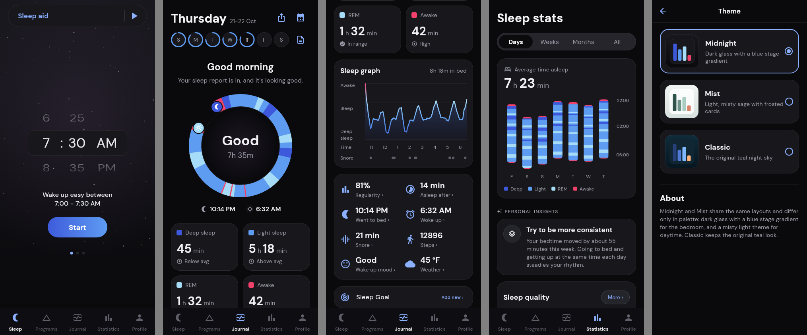
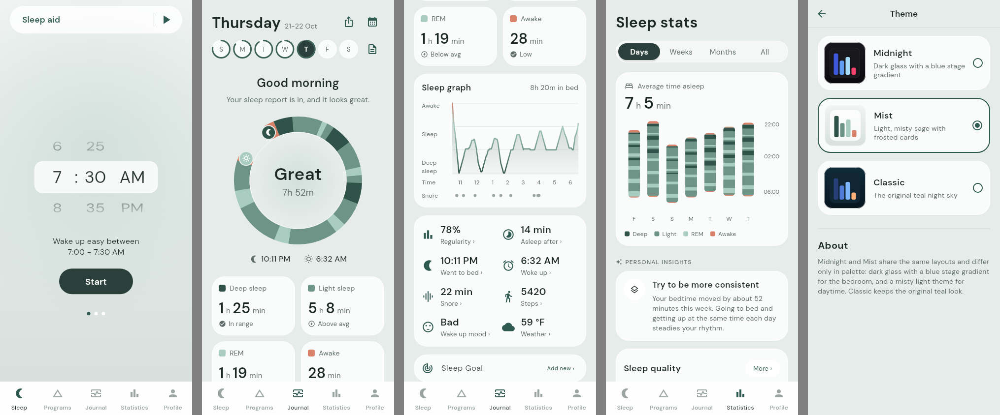
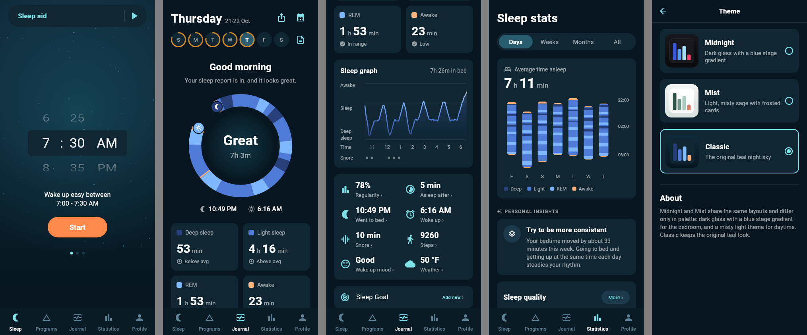

# sleep_tracker (Flutter)

An original sleep-tracking app in the same category as Sleep Cycle, built from
standard techniques — not a copy of their code or models. It runs a full
analysis pipeline on a **simulated night** out of the box, so you can see the
hypnogram, sleep score and smart-alarm logic with no device or native code.

## Run

```bash
cd flutter_app
flutter create .            # one-time: generate android/ ios/ runners (not committed)
flutter pub get
flutter run                 # phone, emulator, or `flutter run -d chrome`
flutter test                # unit tests for the algorithms
```

> The Android runner is committed (it carries the sensing, location and Health
> Connect permissions). For iOS, run `flutter create --platforms=ios .` once.

### Backend

By default the app is local-only. To use the real backend (Firebase Auth,
Firestore sync, streamed sleep aid, weekly reports, weather, subscriptions
through RevenueCat) see [`../backend/README.md`](../backend/README.md):

```bash
flutter run --dart-define=BACKEND=emulator                 # local Firebase emulators + API
flutter run $(../backend/scripts/app_defines.sh <project> <api-url>)   # deployed project
```

### Real tracking and the alarm

The tracking screen records the accelerometer, the ambient light sensor and
(in microphone mode) sound levels, with short clips of loud moments kept on
the phone for as long as Profile › More › Sound detection says (0 nights keeps
none). A foreground service keeps it running with the screen off. Nights
shorter than 20 minutes are too short to analyse; for testing you can save a
sample night instead.

The alarm rings in-app: the smart alarm watches the night's movement inside
the wake-up window and rings at the lightest moment (a regular alarm at the
time), fading the chosen alarm sound in with vibration per Profile › More ›
Vibration. Snooze with the button, two taps anywhere, or by picking the phone
up; smart snooze halves the time left to your alarm each time. An OS
alarm-clock notification is scheduled as a backup in case the app is killed,
and a dying battery rings early. Stopping the alarm runs the morning flow:
wake-up mood (when on) and the one-minute alertness game. To try it quickly:
Profile › More › Database › **Test alarm**, then Start on the Sleep tab.

> This project is authored as source; it wasn't compiled in the environment that
> generated it. If `flutter analyze` flags anything, it'll be a small fix — the
> structure and logic are the substance.

## Structure

```
lib/
  core/sleep_algorithms.dart   # movement, staging, smart alarm, snore (Dart port of sleep_core)
  data/models.dart             # SleepSession, PhasePoint, AlarmSettings
  data/api_client.dart         # client for ../mock-api
  data/night.dart              # a tracked night + journal extras; synthetic sample nights
  data/recorded_night.dart     # replays a recorded night (events CSV) into realistic nights
  data/sleep_aid_catalog.dart  # sleep-aid sections (our own placeholder catalog)
  data/programs.dart           # programs + lessons (our own placeholder content)
  sensing/sleep_tracker.dart   # orchestrates a night; SimulatedNight source for dev
  app_state.dart               # in-memory app state (alarm, settings, nights, sleep aid)
  theme.dart                   # theme entry point (re-exports theme/)
  theme/palette.dart           # SleepPalette: every color/radius/font token, read via context.palette
  theme/{midnight,mist,classic}_theme.dart  # one palette per theme
  theme/app_themes.dart        # AppThemeId list + palette → ThemeData builder
  ui/                          # screens, see "Navigation" below
  ui/widgets/themed.dart       # glass card, pill segments, stage ring/bars, stat + insight cards
test/
tool/theme_screenshots_test.dart  # renders each theme to build/theme_screenshots/
```

## Themes

Pick one in **Profile › Theme** (saved with the other settings; Midnight is the default).

| Theme        | Look                                                                                                                                                                    |
| ------------ | ----------------------------------------------------------------------------------------------------------------------------------------------------------------------- |
| **Midnight** | Near-black glass cards, DM Sans, blue stage gradient (royal blue deep, mid-blue light, pale cyan REM, pink-red awake), a stage ring report and pill segmented controls. |
| **Mist**     | The light counterpart: misty sage-grey air, frosted white cards, forest-ink text and a forest → sage → mint stage scale with terracotta for awake.                      |
| **Classic**  | The original teal night sky with the orange call to action.                                                                                                             |

Screens never hard-code colors: they read `context.palette`, so a new theme is
one new `SleepPalette` file plus an `AppThemeId` entry. Regenerate the previews
with `flutter test tool/theme_screenshots_test.dart`.





## Navigation

Same screen tree and user journey as the original (see
`comparison/nav_map.md` in the research workspace for the reference capture):

```
Onboarding → Welcome (Google / email / log in) → Free-trial explainer (✕ skips)
  → five tabs: Sleep · Programs · Journal · Statistics · Profile

Sleep       sleep-aid pill → catalog sheet → track sheet (download → play)
            time wheel + pager [smart window | regular alarm | no alarm]
            Start → "Remember" placement tip → snooze tip → Tracking
            Tracking: moon, clock, tap alarm → Change alarm sheet, swipe up Stop
            Stop → night analysed → Journal
Programs    program cards → detail (n/N completed, lesson grid)
            → video lesson | swipeable card lesson (completes on last card)
Journal     day header, week strip with quality rings, calendar, weekly report,
            quality ring, wave hypnogram, stat grid, sleep goal, notes, cards
Statistics  Days/Weeks/Months/All; 12 metric charts, each "More ›" → detail
Profile     tiles, gift → Benefits; Settings (Sleep Goal, Sound, Wake up
            phase, Watch, Weekly report, More); Premium (Online backup, Sleep
            aid, Sleep notes → Edit, Wake up mood, Weather, Who's snoring); Help
More        Account, About you, Consent, Health Connect · Motion/Sound
            detection, Placement reminders, Snooze, Vibration, Battery warning ·
            Database (export CSV, **Load sample nights**), Third-party software
```

Before the first night, Journal and Statistics show demo content under an
overlay, as the original does. To explore them without tracking, use
Profile › More › Database › **Load sample nights (prototype)**. Sign-in and
the trial purchase are mocked; if the mock API isn't running, sign-in
continues locally. State (settings, nights, lesson progress, onboarding) is
saved with shared_preferences, so later launches open straight on the tabs.

**Realistic test data with the local placeholders.** When
`extract_placeholders.sh` has been run:

- sample, demo and "stopped" nights replay the APK's recorded night
  (`dummy_sleep_events.csv`: movement + snore events) through our staging,
  jittered per night, instead of the synthetic generator;
- every sleep-aid item and alarm sound plays one of the bundled audio files
  (ambiences for soundscapes, the melodic alarm tracks for the rest);
- video lessons and the microphone snooze tip play the bundled clip.

Without them the app falls back to synthetic nights, mock playback and
illustrations, so a clean checkout still builds and runs.

The analysis is plain Dart and has no device dependency. Real sensing is the one
native piece: swap `SimulatedNight` for a platform-channel source backed by
CoreMotion/AVAudioEngine (iOS) and SensorManager/AudioRecord (Android), and feed
your own trained sound model's frame probabilities into the snore detector.

## Comparison placeholders (local only)

To make the UX comparison fair, the app can load the **real** APK assets as
temporary placeholders — the onboarding Lottie, the sleep-aid catalog + audio,
the app icon, and the real UI copy. These are Northcube's copyrighted material,
so they are **gitignored and never committed or shipped**. The repo ships
`assets/data/strings.en.sample.json` (our own original copy) and falls back to
it when the real files are absent, so the app still builds and runs from a clean
checkout.

To repopulate for a side-by-side demo on your own machine:

```bash
./tools/extract_placeholders.sh /path/to/com.northcube.sleepcycle.apk
# strings.en.json (real UI copy) is produced from the APK string table separately
```

## Our own media

A clean checkout ships everything it plays and draws:

- `assets/audio/own/`: 8 alarm melodies and 10 loopable ambiences (rain,
  wind, ocean, fire, night forest, stream, brown/pink/white noise, droplets),
  synthesised by `tools/generate_media.py` (numpy + ffmpeg). The APK
  placeholders take precedence when present.
- `assets/fonts/`: DM Sans (SIL OFL 1.1).
- `lib/ui/widgets/illustrations.dart`: vector illustrations (placement and
  snooze tips, settings heroes, Benefits), procedural cover art for sleep aid
  and programs, the now-playing equaliser and the animated onboarding intro.
- The alarm screen sun, the alertness game's stars, bursts and confetti are
  painted in code.

## How close is this to Sleep Cycle?

The latest side-by-side audit (APK manifest, assets, strings and 67
screenshots of the original against the clone) is in the project files
(`SleepCycle-analysis/parity/gap-audit.md`). The original has no home-screen widgets, launcher
shortcuts or Quick Settings tile, so there are none to match.

Honest, feature-by-feature. "Design parity" = same approach, our own code/params.
"Gap" = real product work still needed.

| Area                  | Sleep Cycle                                                                               | This app                                                                                                                               | Status                                                |
| --------------------- | ----------------------------------------------------------------------------------------- | -------------------------------------------------------------------------------------------------------------------------------------- | ----------------------------------------------------- |
| Primary navigation    | Sleep / Programs / Journal / Statistics / Profile bottom bar                              | **same five tabs, same order and screen tree**                                                                                         | **Parity**                                            |
| UI text               | full string table, 13 locales                                                             | **runtime string table** (loads real copy locally, ships original)                                                                     | **Parity** (one locale)                               |
| App icon / branding   | custom mark                                                                               | real icon wired as placeholder; original mark in theme                                                                                 | Functional (own brand = gap)                          |
| Onboarding            | full-screen animated Lottie intro + consent perks + wake-time step                        | **full-bleed Lottie intro**, large headline, real perks, **wake-time step**                                                            | **Parity** (placeholder assets)                       |
| Visual identity       | navy/teal palette, rounded font, warm buttons                                             | **own navy + teal palette, warm "sunrise" CTA buttons** (not default-Flutter purple)                                                   | Close; **gap**: custom font                           |
| Hypnogram             | smooth depth "waves"                                                                      | **smooth gradient depth curve** (was stepped bars)                                                                                     | Functional                                            |
| Sample night realism  | learned cyclic staging                                                                    | **cyclic deep-early / REM-late architecture prior**; realistic stage mix + score (fixed all-deep/score-100 bug)                        | Functional                                            |
| Movement tracking     | accelerometer, calibrated, per-minute events                                              | accelerometer aggregator, calibration, 30 s epochs                                                                                     | **Design parity** (needs real sensor feed)            |
| Sleep staging         | learned model (breathing+movement) → 4 stages, smoothed                                   | transparent movement→depth heuristic, Gaussian-smoothed, 4 stages                                                                      | Baseline; **gap**: train a real model                 |
| Smart alarm           | per-night learned thresholds, eased window; rings, snooze, vibration                      | per-night percentile thresholds, eased window; **rings in-app + OS backup**, smart/regular snooze, tap/pick-up snooze, vibration modes | **Parity**                                            |
| Notifications         | bedtime / set-alarm reminder, alertness reminder, weekly report, trial, tracking, battery | **same channels**, all local                                                                                                           | **Parity** (no push server)                           |
| Morning flow          | wake-up mood sheet, Awake alertness game                                                  | **mood sheet + our own alertness game** with baseline                                                                                  | **Parity**                                            |
| Night sounds          | clips per night, playback, kept N nights                                                  | **clips recorded while tracking, Journal player, pruning**                                                                             | **Parity** (who's snoring: label only)                |
| Light                 | ambient light metric + chart                                                              | **light sensor per epoch, Light chart**                                                                                                | **Parity**                                            |
| Snore detection       | sound-event model + event rules                                                           | event rules ready; **you plug in the model**                                                                                           | Rules parity; **gap**: your sound model               |
| Hypnogram + score     | polished native charts                                                                    | Flutter hypnogram + score + trends screen                                                                                              | Functional                                            |
| Tracking visuals      | live animated night view                                                                  | animated night view (breathing moon, stars)                                                                                            | Functional                                            |
| Sleep aid             | ExoPlayer library + streamed content                                                      | **real catalog (16 tracks) + just_audio playback** of bundled tracks, premium lock                                                     | **Parity** for free tracks; **gap**: streamed content |
| Sleep notes           | tag set, each with a tip, correlated with quality                                         | **real tag set + tips** (snackbar), from string table                                                                                  | **Parity** (needs correlation)                        |
| Wake-up mood          | 5-point morning mood log                                                                  | **5-point mood row** on results                                                                                                        | **Parity** (needs logging/correlation)                |
| Statistics            | trends over time                                                                          | trends screen (score line, stage bars)                                                                                                 | Functional                                            |
| Accounts / cloud sync | Ory + GCP backend                                                                         | mock API only                                                                                                                          | **gap**: real backend                                 |
| Wear OS / HealthKit   | yes                                                                                       | Health Connect only                                                                                                                    | **gap**: Wear OS companion                            |
| Paywall / billing     | dynamic server-driven                                                                     | server-driven mock paywall (no billing)                                                                                                | Partial; **gap**: StoreKit/Billing                    |

**Summary:** with the APK assets wired in as local placeholders, the _surface_
(navigation, onboarding, sleep aid, sleep notes, mood, text) now reads very
close to the original. The remaining substance gaps are the same two as before —
(1) your own trained ML models for staging and snore, and (2) native sensing +
background service per platform — plus standard product build-out (real backend,
own brand assets, streamed audio content, wearables, billing).
